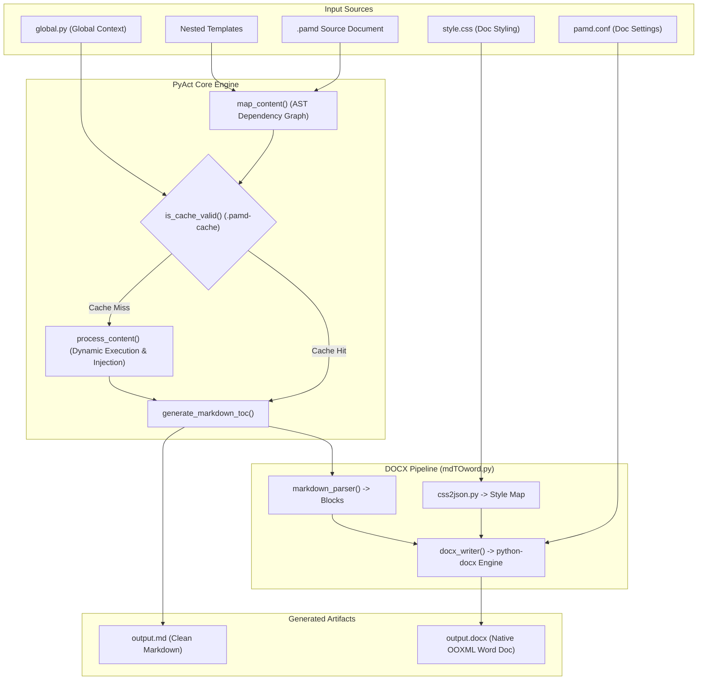

# 🛠️ PyAct Technical Architecture Sheet (For AI Assistants & Engineers)

> **Audience**: AI Agents, LLM Pair Programmers, and Core Maintainers.  
> **Purpose**: Single Source of Truth (SSOT) detailing PyAct's architecture, document lifecycles, data contracts, AST compilation, OOXML Word rendering, and critical engineering invariants.

---

## 1. Executive Summary & Core Philosophy

**PyAct** is a reactive, dual-engine document compilation framework. It introduces the `.pamd` (Python Active Markdown) format, which binds arbitrary Python logic directly with Markdown document templates.

PyAct executes document builds through a two-stage compilation pipeline:
1. **Stage 1 (Evaluation & AST Merging)**: Executes embedded Python code in an isolated execution namespace, extracts context dictionaries, recursively resolves child template ASTs, and merges them into flat GitHub-Flavored Markdown.
2. **Stage 2 (Native Typography & OOXML Synthesis)**: Parses the flattened Markdown into structured element blocks and translates them into styled Microsoft Word (`.docx`) OpenXML structures or publishes clean Markdown (`.md`).



---

## 2. File Format Specification: `.pamd`

A `.pamd` file is stored on disk as strict JSON containing an array of cells (analogous to Jupyter notebooks, but designed specifically for documents):

```json
{
  "cells": [
    {
      "cell_type": "code",
      "source": [
        "import pamd_helpers\n",
        "def context():\n",
        "    return {\"beam\": \"IPE 300\", \"length\": 6.0}\n"
      ]
    },
    {
      "cell_type": "markdown",
      "source": [
        "# Structural Calculation\n",
        "Selected Profile: **<ctx>beam</ctx>** with length <ctx>length</ctx> m.\n"
      ]
    }
  ]
}
```

### The `context()` Contract
- Every `.pamd` file containing `<ctx>` variables **must** define a top-level callable named `context()`.
- `context()` must take 0 arguments and return a `dict` mapping string keys to stringable or helper-generated values.
- In `core.py`, dynamic execution mocks Python's `linecache.cache[filename]` before calling `compile()` and `exec()`. This ensures that tools relying on source inspection (e.g. `inspect.getsource()` used by `pamd_helpers.equation`) succeed inside dynamic execution.

---

## 3. Template DSL & Tag Grammar

| Tag Syntax | Semantics | Target Engine | Processing Phase |
| :--- | :--- | :--- | :--- |
| `<ctx>var_name</ctx>` | Injects local variable from `context()` dictionary | Core Engine | Dynamic string substitution during `process_content` |
| `<glb>var_name</glb>` | Injects global variable from `global.py`'s `global_context()` | Core Engine | Dynamic string substitution across all templates |
| `<tmp>filename</tmp>` | Recursively compiles child `.pamd` relative to current path | Core Engine | Recursive AST branch resolution in `map_content` |
| `<toc/>` or `<toc title="..."/>` | Injects hyperlinked Table of Contents | Core + Word | Replaced with Markdown links in `.md`; native dynamic TOC field in `.docx` |
| `<pagebreak/>` / `<pb/>` | Forces page break in Word export | Word Engine | Emits `('pagebreak',)` -> `doc.add_page_break()` |
| `<sectionbreak/>` / `<sb/>` | Creates new Word section on new page | Word Engine | Emits `('sectionbreak',)` -> `doc.add_section(WD_SECTION.NEW_PAGE)` |
| `<landscape>...</landscape>` | Switches orientation to landscape and back | Word Engine | Emits `('landscape_start',)` and `('landscape_end',)` |
| `> [!TYPE] Title` | Alert Callout Box (`NOTE`, `TIP`, `IMPORTANT`, `WARNING`, `CAUTION`) | Markdown + Word | Blockquote in `.md`; styled 1x1 accented table box with background fill in `.docx` |
| `\| :--- \| :---: \| ---: \|` | Markdown Table with alignment | Markdown + Word | Parsed into native Word table with cell alignments, borders, and repeat headers |

---

## 4. Configuration Systems & Separation of Concerns

> [!IMPORTANT]
> **Strict Separation Rule**: `global.py`, `pamd.conf`, and `style.css` serve distinct purposes and must never be unified or mixed together.

```
Project Root
├── global.py      <-- Pure Python context (author, company, project codes)
├── pamd.conf      <-- INI Document settings (margins, headers, footers, metadata)
├── style.css      <-- CSS Visual Styling (fonts, table borders, colors, line heights)
└── main.pamd      <-- Active document content & logic
```

### A. `global.py` (Global Data Context)
- **Role**: Supplies global variables available to all templates via `<glb>key</glb>`.
- **Contract**: Pure Python file. Must expose `global_context() -> dict`.
- **Invalidation**: Monitored by `.pamd-cache`. Changing `global.py` invalidates all cached templates.

```python
def global_context():
    return {
        "project_code": "CIVIL-2026",
        "company": "Acme Engineering Ltd"
    }
```

### B. `pamd.conf` (Word Document Settings)
- **Role**: Configures document-level Word properties (`pamd_cli/pyact/conf_parser.py` & `mdTOword.py`).
- **Contract**: Standard INI configuration format.
- **Sections**:
  - `[Header]` & `[Footer]`:
    - 3-zone layout: `left`, `center`, `right` (automatically positioned via tab stops at page margins).
    - Tokens `{page}` and `{pages}` inject native dynamic Word fields (`PAGE` and `NUMPAGES`).
    - Typography overrides: `font_name`, `font_size`, `color`, `bold`, `italic`.
  - `[Metadata]`:
    - Maps key-values into Word `core_properties` (`title`, `author`, `subject`, `keywords`, `category`, `comments`, `language`).
  - `[Page]`:
    - `orientation`: `portrait` | `landscape`.
    - `size` / `paper_size`: `a4` | `letter` | `legal`.
    - `margins` / `margin`: e.g. `1in`, `2.5cm`, `20mm`.
    - Specific margins: `margin_top`, `margin_bottom`, `margin_left`, `margin_right`.

### C. `style.css` (Visual Typography & Elements)
- **Role**: Mapped by `css2json.py` and applied by `mdTOword.py` to elements.
- **`!important` handling**: Automatically stripped from rule values during parsing so numeric conversions (`Pt()`, `RGBColor`) remain valid.
- **Supported Selectors**:
  - `body`: Document Normal style (font, size, line-height, paragraph margins).
  - `h1` through `h6`: Heading typography, space before/after, page-break-before.
  - `table`: Width (`100%`, `auto`, dimensions), alignment (`center`, `left`, `right`), borders (`border`, `border-style`, `border-color`, `border-width`), padding (`padding: 6pt 8pt`), and Word style overrides (`style: "Table Grid"`).
  - `th` / `table_header`: Header background shading (`background-color`), font color, bolding, and alignment.
  - `td` / `table_cell`: Cell typography, alignment, background shading.
  - `tr:nth-child(even)`: Alternating row background shading (zebra striping).
  - `code`: Monospace font (`Consolas`), font size, background badge shading (`#F0F2F5`).
  - `hyperlink`: URL text color, underline toggle.
  - `list`: Margins, font settings for bullet and numbered lists.
  - `equation`: Paragraph alignment and margins around LaTeX equations.

---

## 5. Subsystems Deep Dive

### 5.1 Compilation & Caching Pipeline (`core.py`, `cli.py`)
1. **Tree Mapping (`map_content`)**:
   Recursively parses `.pamd` files, builds a nested JSON build tree detailing file paths, required `<ctx>` imports, `<glb>` globals, and nested `<tmp>` templates.
2. **Cache Validation (`is_cache_valid`)**:
   Checks `.pamd-cache/<filename>.cache.md`. The cache is marked invalid if `global.py`, the target `.pamd` file, or any child `.pamd` template file has a modification time (`mtime`) newer than the cache file.
3. **Execution & Assembly (`process_content`)**:
   If invalid, executes code cells, populates context, recursively compiles templates, and measures file execution timings for `.pamd-cache/build.log`.
4. **Markdown TOC Synthesis (`generate_markdown_toc`)**:
   When emitting `.md` output, replaces `<toc/>` with a clean, hierarchically indented Markdown list using GitHub-compatible anchor slugs (`make_github_slug`).

### 5.2 Word Engine (`mdTOword.py`)

#### A. Structured Block Parsing (`markdown_parser`)
Deconstructs Markdown into a stream of typed tuples:
- `('heading', level, text)`
- `('paragraph', text)`
- `('callout', type, title, body_lines)`
- `('table', [raw_lines])`
- `('list', text, type, number)`
- `('math', latex_string)`
- `('toc', title)`
- `('pagebreak',)`, `('sectionbreak',)`
- `('landscape_start',)`, `('landscape_end',)`

#### B. Table Rendering (`_apply_table_styling`)
- **Borders**: Injects `<w:tblBorders>` with custom styles (`single`, `dashed`, `dotted`, `double`, `none`), colors, and sizes.
- **Margins**: Injects `<w:tblCellMar>` for cell padding.
- **Repeat Headers**: On `table.rows[0]`, injects `<w:tblHeader/>` so Word repeats table headers across page breaks.
- **Split Prevention**: On all rows, injects `<w:cantSplit/>` to prevent mid-row pagination breaks.
- **Markdown Alignments**: Scans `| :---: | ---: |` to apply `CENTER`, `RIGHT`, or `LEFT` to cells.
- **Rich Cells**: Runs `_process_inline()` on cell paragraphs so bold, italic, code, math, and links work inside table cells.

#### C. Alert Callout Boxes (`_add_callout_box`)
- Renders GitHub-flavored alert syntax (`> [!NOTE]`, `> [!TIP]`, `> [!IMPORTANT]`, `> [!WARNING]`, `> [!CAUTION]`) and blockquotes as 1x1 tables.
- Table width is forced to 100% (`<w:tblW w:w="5000" w:type="pct"/>`).
- Injects a thick left border (`w:sz="36"`) tinted to the alert theme:
  - `IMPORTANT`: `#8250DF` (Purple) | Background: `#F8F5FF`
  - `NOTE`: `#0969DA` (Blue) | Background: `#F0F7FF`
  - `TIP`: `#1A7F37` (Green) | Background: `#F0FFF4`
  - `WARNING`: `#9A6700` (Orange) | Background: `#FFFBEB`
  - `CAUTION`: `#CF222E` (Red) | Background: `#FFF1F2`
  - `BLOCKQUOTE`: `#D0D7DE` (Gray) | Background: `#F6F8FA`

#### D. Table of Contents Engine (`_add_table_of_contents`)
- Injects native Word TOC field code: `TOC \o "1-3" \h \z \u` and enables `<w:updateFields w:val="true"/>`.
- **Pre-populated Cache**: Pre-scans all subsequent document headings, generating right-aligned dot leader tab stops (`WD_TAB_LEADER.DOTS`) and dynamic `PAGEREF` fields.
- **Clickable Hyperlinks**: Injects `<w:hyperlink w:anchor="_Toc_X">` wrapping each entry, paired with matching `<w:bookmarkStart>` and `<w:bookmarkEnd>` tags around heading elements in the document body.

#### E. Ordered List Numbering Restart (`_restart_list_numbering`)
- Word natively continues ordered list numbering from prior lists unless explicitly restarted.
- When an ordered list item has `num == 1`, `_restart_list_numbering` queries `doc.part.numbering_part.numbering_definitions._numbering`, allocates a new `<w:numId>`, references the abstract numbering definition, and injects `<w:lvlOverride>` with `<w:startOverride w:val="1"/>`.

#### F. Inline Text Processing (`_process_inline`)
- Parses regex patterns in order:
  1. LaTeX display equations `$$...$$` and inline `$ ... $` (via `math2docx.add_math`)
  2. Images `` with optional HTML caption spans
  3. Hyperlinks `[text](url)`
  4. Footnote definitions `[^1]: ...` and references `[^1]`
  5. Bold `**...**` and italic `*...*`
  6. Inline code `` `...` `` (rendered in `Consolas` with `<w:shd w:fill="F0F2F5"/>`)

---

## 6. Codebase File Map & Module Responsibilities

```
pyact_cli/
├── pamd_helpers/               <-- Helper library imported by user .pamd code cells
│   ├── __init__.py             <-- Exports equation, plot, callout, table, image, lists, Footnote
│   ├── unit.py                 <-- Physical quantity Unit class (math wrapper preserving units)
│   └── catalogue/              <-- Standard engineering/science databases (Civil, Chem, Bio)
├── pyact/                      <-- Core compiler package
│   ├── __init__.py             <-- Package version and public API exports
│   ├── cli.py                  <-- Entrypoint CLI (init, compile, cache, lint flags)
│   ├── core.py                 <-- AST mapping, execution namespace, TOC generator
│   ├── mdTOword.py             <-- Markdown tokenizer & DOCX OOXML rendering engine
│   ├── css2json.py             <-- CSS parser, comment stripper, !important cleaner
│   ├── conf_parser.py          <-- pamd.conf parser (headers, footers, metadata, page)
│   ├── py2tex.py               <-- Python AST to LaTeX equation converter
│   ├── scaffold.py             <-- pyact init templates generator
│   ├── linter.py               <-- Static analyzer for unused templates and broken tags
│   └── style.css               <-- Default packaged stylesheet
├── setup.py                    <-- setuptools packaging definition
└── README.md                   <-- User-facing package documentation
```

---

## 7. Standard Helper Library (`pamd_helpers`)

| Function / Class | Signature | Description |
| :--- | :--- | :--- |
| `equation` | `(func: Callable, values: List[Any]) -> str` | Converts a Python lambda into LaTeX with computed values and Greek symbol support. |
| `plot` | `(fig_or_plt, caption="", filename=None, dpi=300) -> str` | Saves a Matplotlib/Pillow figure to `images/` and returns Markdown image syntax with caption. |
| `callout` | `(text: str, callout_type="note", title=None) -> str` | Produces GitHub alert syntax (`> [!TYPE] Title\n> Body`). |
| `table` | `(headers: List, values: List[List], caption="", add_no=False) -> str` | Builds Markdown table with caption and optional auto-numbering column. |
| `image` | `(link: str, caption: str) -> str` | Emits Markdown image with centered italic HTML caption span. |
| `hyperlink` | `(caption: str, link: str) -> str` | Emits Markdown link `[caption](link)`. |
| `ordered_list` | `(items: List[str]) -> str` | Emits 1-indexed numbered list. |
| `unordered_list` | `(items: List[str]) -> str` | Emits bullet list. |
| `checklist` | `(items: List[str]) -> str` | Emits task list `- [ ] Item`. |
| `Footnote` | `(id: int, text: str)` | Object managing footnote annotation `fn.adnotation()` and definition `fn.define_string()`. |
| `Unit` | `(val: float, unit: str)` | Wraps numbers with physical units; behaves as a float in math while retaining unit metadata. |

---

## 8. Critical Invariants & Rules for AI Assistants

When modifying this repository, any AI assistant MUST adhere to the following rules:

1. **Preserve Decoupled Configs**: Never merge `pamd.conf` into `global.py` or vice versa. `global.py` is runtime template data; `pamd.conf` is document-level Word publishing metadata.
2. **Never Break Word TOC Pre-population**: When generating DOCX TOCs, you must retain the pre-populated entry runs between `separate` and `end`. Many environments (LibreOffice, previewers, mobile Word) do not evaluate fields on open.
3. **Preserve Dynamic Linecache Mocking**: In `core.py`, never remove `linecache.cache[filename] = ...` before executing code cells; doing so breaks `inspect.getsource()` inside lambda equations.
4. **Preserve Clean CSS Values**: Always ensure `css2json.py` strips `!important` from rule values so downstream functions parsing colors and measurements do not encounter `ValueError`.
5. **Always Clean Up Scratch Files**: Temporary test scripts, scratch notebooks, or test docx files must be deleted immediately after testing.
6. **Preserve Table OOXML Invariants**: Tables require `<w:tblHeader/>` on row 0 and `<w:cantSplit/>` on all rows to ensure professional printing across page boundaries.

---

## 9. Common CLI & Verification Commands

```powershell
# 1. Scaffold a new project
python -m pyact.cli init my_report --template engineering

# 2. Compile to Markdown and Word with custom CSS and Config
python -m pyact.cli my_report.pamd -o my_report.md --docx my_report.docx --css style.css --conf pamd.conf

# 3. Force rebuild ignoring cache
Remove-Item -Path ".pamd-cache" -Recurse -Force -ErrorAction SilentlyContinue
python -m pyact.cli test_all_features.pamd -o test_all_features.md --docx test_all_features.docx

# 4. Run PyAct Linter
python -m pyact.cli test_all_features.pamd --lint

# 5. Quick XML inspection of generated DOCX
python -c "import docx; doc = docx.Document('test_all_features.docx'); print('Tables:', len(doc.tables)); print('Paragraphs:', len(doc.paragraphs))"
```
